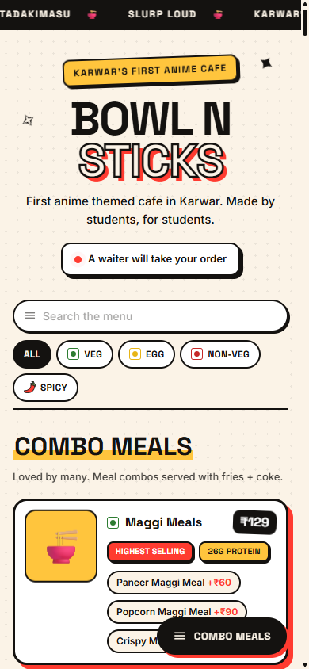
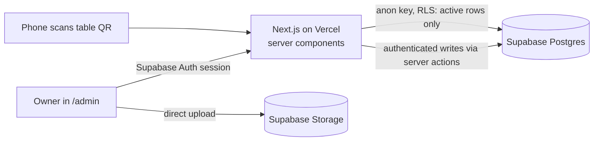

# Bowl n Sticks

QR digital menu and admin panel for an anime-themed cafe in Karwar. Customers scan the code on their table and get a fast, phone-first menu. The owners edit everything themselves: sections, dishes, variants, photos, order, and they see what people look at.

Freelance client project. **Live:** https://bowl-n-sticks.vercel.app

<p>
  
  &nbsp;
  
</p>

## Features

**Customer menu**
- One permanent QR per table (`/t/T1`). The code never changes, so cards never get reprinted when the menu does.
- Search, veg / egg / non-veg / spicy filters, jump-to-section bar, variants and add-ons with prices.
- Server-rendered, no client-side data fetching for the menu itself.

**Admin panel** (`/admin`)
- Sections, dishes and options: create, edit, hide, drag-and-drop reorder (dnd-kit).
- Photos upload straight from the browser to Supabase Storage, with fresh filenames so the CDN never serves a stale image.
- Analytics: menu opens per table, dish views, top dishes and a daily trend. No IP, user agent, cookie or device id is stored.
- "Needs attention" lists (dishes with no photo or price, hidden or empty sections), each linking to where you fix it.
- Printable QR sheet for every table.
- Cafe name, contact and hero copy come from the database, so a rebrand is a form submit.

## How it's built



- **No separate backend.** Server components read the menu; server actions do the writes.
- **Row Level Security does the authorization.** `anon` can only read active rows. Every write needs an authenticated session. The two public write paths (`record_event`, `record_item_views`) are narrow `security definer` functions with validated input.
- **Silent failures are treated as bugs.** Supabase returns `{ data, error }` instead of throwing, and RLS filters rows without an error. Every update and delete selects the affected ids so "0 rows changed" is reported, not shown as success.
- **Reordering is one Postgres function call** that rewrites positions in a single statement, not N updates from the browser.
- **Schema is versioned.** Numbered migrations in `db/migrations/` are tracked in a `schema_migrations` table and mirrored into `db/schema.sql`, so a fresh build matches a migrated database.

## Tests

```bash
cd web && npm test
```

83 checks across the server actions (items, sections, options, reordering). They run the real action code against a fake Supabase client that records every query, and assert three things per action: the query it builds, what it returns on failure, and whether it refreshes the public menu.

## Stack

Next.js 16 (App Router, server actions), React 19, Supabase (Postgres, Auth, Storage, RLS), Tailwind CSS 4, dnd-kit, qrcode, Vercel.

## Run locally

```bash
cd web
npm install
# web/.env.local: NEXT_PUBLIC_SUPABASE_URL, NEXT_PUBLIC_SUPABASE_ANON_KEY
npm run dev
```

Database tooling lives at the repo root: `npm run migrate`, `npm run migrate:status`, `npm run sql -- "select ..."`. See [db/README.md](db/README.md). How the app fits together: [ARCHITECTURE.md](ARCHITECTURE.md).
