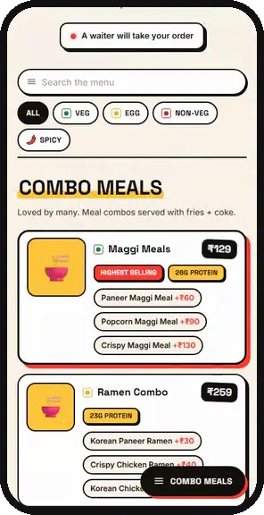
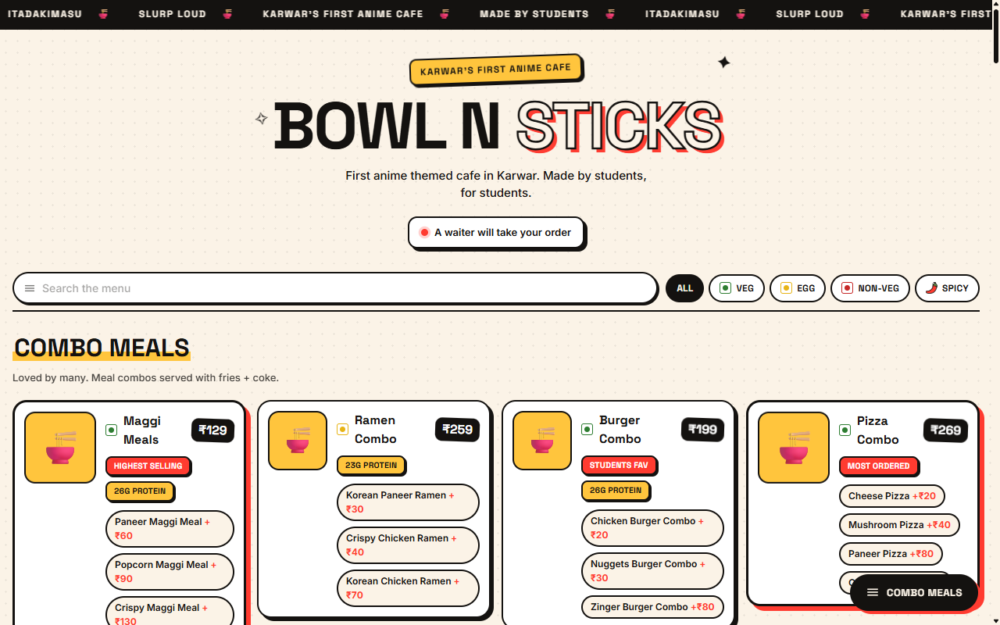
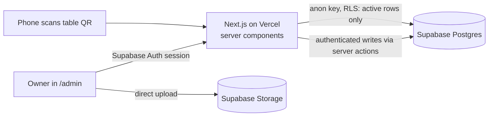

# Bowl n Sticks

QR menu and admin panel for an anime-themed cafe in Karwar. Customers scan the code on their table and get a fast, phone-first menu. The owners run the menu themselves: sections, dishes, variants, photos and order, plus what people actually look at.

Freelance client project, live for a real cafe.

**Live menu:** https://bowl-n-sticks.vercel.app &nbsp;·&nbsp; **Film:** [docs/launch.mp4](docs/launch.mp4) (13 s)

[](docs/launch.mp4)

<p>
  
  &nbsp;
  
</p>

## Contents

- [Features](#features)
- [Architecture](#architecture)
- [Security model](#security-model)
- [Database](#database)
- [Tests](#tests)
- [Stack](#stack)
- [Run locally](#run-locally)

## Features

### Customer menu

- **One permanent QR per table** (`/t/T1`). The code encodes the table, not the menu, so printed cards survive every menu change.
- **Search and filters:** veg, egg, non-veg and spicy, with a jump-to-section bar.
- **Variants and add-ons** with their own prices. A dish with no price shows as MRP.
- **Server-rendered.** The page arrives as finished HTML. No client-side fetch, no loading spinner.

### Admin panel (`/admin`)

- **Menu editing:** create, edit and hide sections, dishes and options. Drag-and-drop reorder (dnd-kit).
- **Photos** upload straight from the browser to Supabase Storage under fresh random filenames, so the CDN never serves a stale image.
- **Analytics:** menu opens per table, dish views, top dishes and a daily trend. No IP, user agent, cookie or device id is stored.
- **Needs attention:** dishes with no photo or price, hidden dishes, hidden or empty sections. Each count links to the list where you fix it.
- **Printable QR sheet** for every table.
- **Cafe settings:** name, tagline, address, phone, timings, socials and house rules live in the database, so a rename is a form submit, not a deploy.

## Architecture



- **No separate backend.** Server components read the menu, server actions do the writes. `web/lib/` is the backend layer: reads in `menu.js` / `adminMenu.js`, writes in `actions/`.
- **Three Supabase clients, three identities:** public reads (anon key), the signed-in admin's session (server), and the browser (login and logout only).
- **Cached menu, explicit refresh.** Vercel serves cached HTML to diners. Every successful write calls `revalidatePath`, so an edit shows up on the next scan.
- **Writes return, reads throw.** A failed write returns a readable message and keeps the open form intact. A failed read throws to the error page, so a database outage never renders as an empty menu.
- **Silent failures are treated as bugs.** Supabase returns `{ data, error }` instead of throwing, and RLS drops rows without an error. Every update and delete selects the affected ids, so "0 rows changed" is reported instead of shown as success.

The full walkthrough (request traces, the RLS model, where everything lives) is in [ARCHITECTURE.md](ARCHITECTURE.md).

## Security model

Authorization lives in Postgres, not in the app. The publishable key is in every browser, so anything it can do, anyone can do.

| Who | Can do | Enforced by |
|---|---|---|
| `anon` (any diner) | Read the active cafe, sections, dishes and tables, plus dish options. Nothing else. | RLS `select` policies, `using (active)` |
| `anon` | Record a menu open or dish views, and only that | Two `security definer` functions (`record_event`, `record_item_views`) with validated input, a fixed `search_path` and `execute` revoked from `public` |
| `authenticated` (the owners) | Full read and write on the menu, settings and analytics | RLS `for all to authenticated` policies |
| Not signed in, on `/admin/*` | Redirected to login | `web/proxy.js` (Next 16's request proxy) |

The proxy protects pages. RLS protects data, and it still holds if someone skips the app and calls the Supabase API directly. Sign-ups are off; admin accounts are created by hand. "Hidden" means the anon key cannot fetch the row at all, not that it is hidden with CSS.

## Database

Six tables: `cafe`, `menu_section`, `menu_item`, `menu_item_option`, `dining_table`, `analytics_event`.

- **Versioned schema.** Nine numbered migrations in [`db/migrations/`](db/migrations), tracked in a `schema_migrations` table in the database and mirrored into `db/schema.sql`, so a fresh build matches a migrated database.
- **Reordering is one function call.** `reorder_menu_items(ids uuid[])` rewrites every position in a single statement instead of N updates from the browser. It runs as `security invoker`, so RLS still applies.
- **Checks in the schema:** `price >= 0`, `not null`, foreign keys. The last line of defence after browser and server validation.
- **Storage paths, not URLs.** Rows store the path inside the bucket, so a Supabase project change does not break every photo.

Tooling at the repo root: `npm run migrate`, `npm run migrate:status`, `npm run sql -- "select ..."`. See [db/README.md](db/README.md).

## Tests

```bash
cd web && npm test
```

83 checks across the server actions (items, sections, options, reordering). They run the real action code against a fake Supabase client that records every query, and assert three things per action: the query it builds, what it returns on failure, and whether it refreshes the public menu. No test runner, no database, no network. Details in [web/test/README.md](web/test/README.md).

## Stack

Next.js 16 (App Router, server actions), React 19, Supabase (Postgres, Auth, Storage, RLS), Tailwind CSS 4, dnd-kit, qrcode, Vercel.

A scheduled GitHub Action ([supabase-keepalive.yml](.github/workflows/supabase-keepalive.yml)) reads one row every three days so the free-tier project is never paused for inactivity, and fails loudly if the database stops answering.

## Run locally

```bash
cd web
npm install
# web/.env.local: NEXT_PUBLIC_SUPABASE_URL, NEXT_PUBLIC_SUPABASE_ANON_KEY
npm run dev
```

Then open http://localhost:3000 for the menu, `/t/T1` for a table, and `/admin` for the panel.
